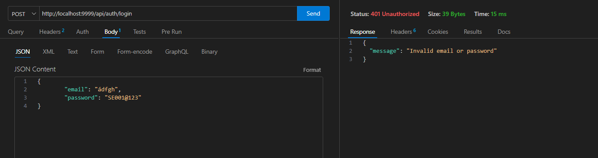
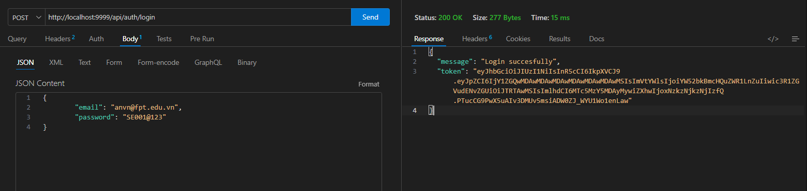
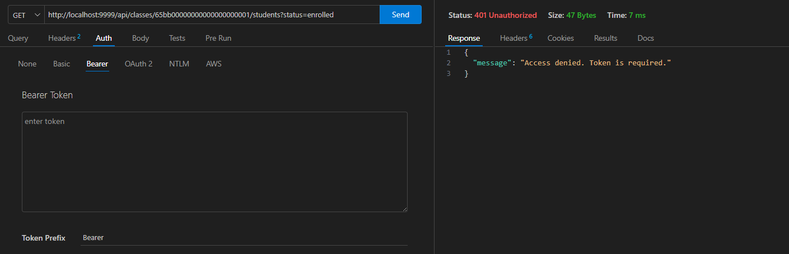
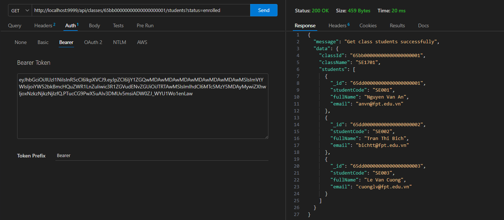
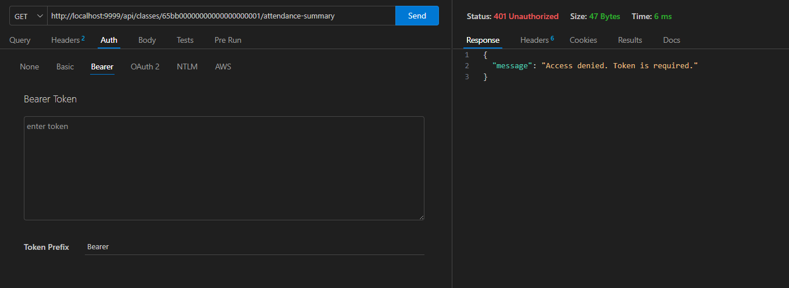
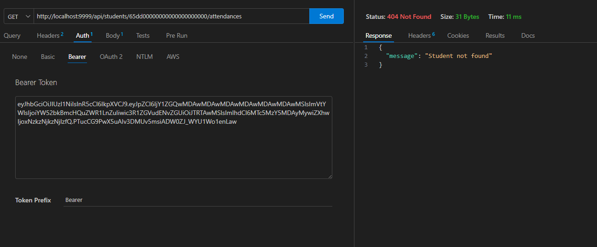
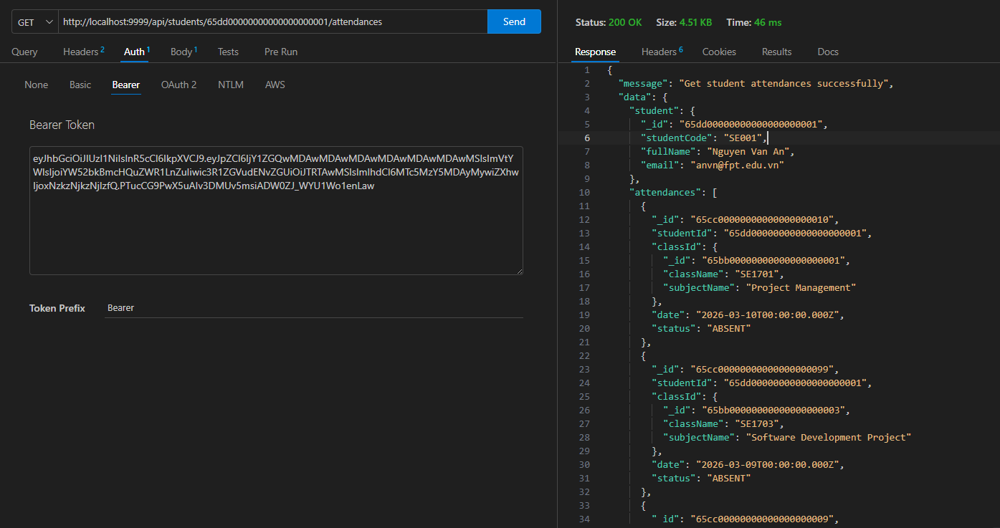

Requirement 1:
 POST login: POST /api/auth/login

Requirement 2:
 Get Student in a Class: GET /api/classes/:id/students?status=enrolled

Requirement 3:
Get Attendance Summary of a Class : GET /api/classes/:id/attendance-summary

Requirement 4:
Get Attendance of a Student : GET /api/students/:id/attendances

.png)
